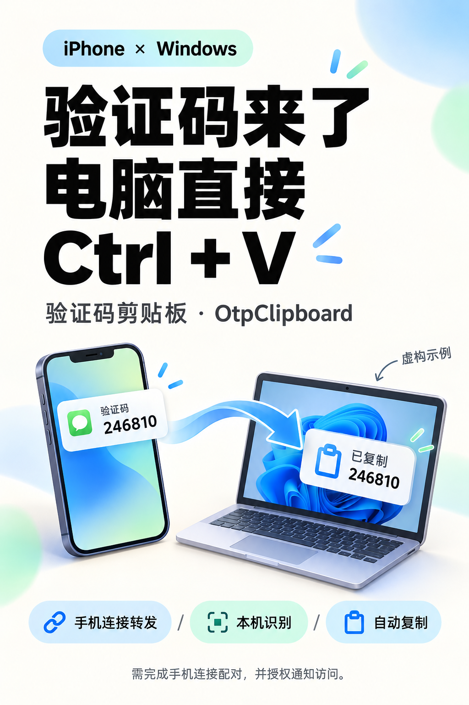
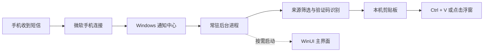

<div align="center">
  
  <h1>验证码剪贴板</h1>
  <p><strong>手机收到验证码，电脑直接 Ctrl + V。</strong></p>
  <p>OtpClipboard · Windows 桌面效率小工具</p>
  <p>
    <a href="https://github.com/wzp100/OtpClipboard/actions/workflows/ci.yml"></a>
    
    
    
    <a href="LICENSE"></a>
  </p>
  <p><a href="#快速上手">快速上手</a> · <a href="#隐私与数据">隐私说明</a> · <a href="docs/development.md">开发指南</a> · <a href="docs/promotion/xiaohongshu.md">宣传素材</a></p>
</div>

---

电脑登录时，不用再拿起手机、记住数字、切回来手动输入。验证码剪贴板从 **“手机连接（Phone Link）”转发到 Windows 通知中心的通知** 中提取验证码，自动写入剪贴板，也可以在输入框旁点一下填入。

应用本身不联网，识别在本机完成。手机通知的转发由微软“手机连接”负责，连接方式和支持范围以该应用为准。

## 能做什么

| 功能 | 使用体验 |
| --- | --- |
| 自动识别 | 支持 4–8 位数字验证码，以及“验证码 / 动态码 / OTP / verification code”等中英文关键词 |
| 自动复制 | 收到并识别后写入剪贴板，直接按 **Ctrl + V** |
| 光标旁提示 | 显示 8 秒，点击填入；特殊输入框可手动粘贴 |
| 常驻托盘 | 收起窗口后继续监听，按 **Ctrl + Alt + O** 唤回 |
| 开机自启 | 可选择登录 Windows 后自动后台运行 |
| 处理记录 | 查看已复制、未匹配、已过滤或失败；磁盘只保存状态与时间 |

> 示例验证码统一使用虚构的 `246810`，宣传插画不是实际软件截图。

<details>
<summary>查看宣传配图（虚构演示）</summary>
<p align="center"></p>
</details>

## v1.0.5 更新

这一版集中处理“小工具不该让人有负担”的两件事：

- **界面不再空白。** 主界面通过本机管道读取后台快照，重新打开和后台状态刷新都使用同一份数据。
- **后台不再忙等。** 修复隐藏浮窗持续重绘，也补上原生窗口消息分发。开发版在 24 逻辑处理器电脑上完成 30 秒空闲采样，平均 CPU 为 `0.00%`，私有内存约 16 MiB。这个结果仅用于本次回归验证。
- **关闭界面不等于退出。** UI 进程关闭后立即退出，释放 WinUI 占用；后台仍负责通知监听、剪贴板与托盘，需要界面时再按需启动。
- **隐私实现与界面说明一致。** 验证码和通知正文只存在于当前运行进程内存；历史文件只保存处理分类和时间。

## 工作流程



应用通过系统通知事件工作，不定时扫描。手动“扫描通知中心”可用于排查已有通知。

后台进程只创建原生消息窗口，不需要常驻 WinUI 页面。点击托盘、打开应用或按 **Ctrl + Alt + O** 时再启动界面进程；关闭界面不会停止监听。

## 快速上手

### 1. 准备手机连接

- 应用包最低系统版本为 **Windows 10 1809**；实际使用还需满足微软“手机连接”对系统和手机的要求，建议使用 Windows 11。
- 以 iPhone 为例：先与“手机连接”完成配对，再在 **设置 → 蓝牙 → 已连接电脑 → 共享系统通知** 中开启通知共享。
- 确认手机通知能出现在 Windows 通知中心。仅出现在“手机连接”应用内的内容，工具无法读取。

### 2. 安装或从源码运行

下载 [v1.0.5 Windows x64 安装程序](https://github.com/wzp100/OtpClipboard/releases/download/v1.0.5/OtpClipboard-1.0.5.0-Setup.exe)，或前往 [Releases](https://github.com/wzp100/OtpClipboard/releases) 查看更新日志和 SHA-256 校验文件。其他架构请参考源码与打包说明。

安装后可先点击“设置 → 预览悬浮提示”，用虚构值 `246810` 检查提示效果。预览不会复制验证码。

安装包名称为 `OtpClipboard-<版本>-Setup.exe`。当前打包方案采用自签名证书，安装时需管理员权限导入到“本地计算机 → 受信任人”。Windows 可能显示未知发布者提示；请先核实来源。详细步骤见 [打包与安装说明](docs/packaging.md)。

如果 Release 标签页只显示标题或一直空白，可直接使用上面的安装包链接，并尝试刷新页面、更换网络或在 GitHub 页面链接末尾加 `?`。GitHub 前端偶尔会遇到 CDN 或缓存加载异常，具体资源链接不依赖该页面渲染。

### 3. 授权并开始使用

1. 打开应用，点击 **授权通知访问**，在系统提示中允许。
2. 授权成功后自动监听；后续启动会检查授权并恢复监听。
3. 收到验证码后，在目标输入框按 **Ctrl + V**，或点击光标旁的提示。

> 识别到验证码会覆盖当前剪贴板内容。浮窗填入受目标窗口权限和输入框类型影响，管理员窗口或特殊控件可能需要手动粘贴。

## 隐私与数据

| 数据 | 如何处理 |
| --- | --- |
| 通知正文与来源摘要 | 仅用于当前运行期间的识别和界面展示，不写入历史文件 |
| 验证码 | 仅保留在当前进程内存和当前剪贴板中，不写入应用历史文件 |
| 磁盘历史 | 最多 200 条，仅保留处理分类 `Kind` 和时间 `Time` |
| 旧版历史 | 新版首次读取成功后，立即移除旧文件中的验证码、标题和正文等字段 |
| 剪贴板历史与同步 | 写入时关闭 Windows 剪贴板历史与跨设备漫游选项 |
| 网络 | 应用没有联网功能、遥测或远端识别服务 |

本地文件位于 `%LOCALAPPDATA%\Packages\<包系列名>\LocalState\`：`preferences.json` 保存设置，`notification-history.json` 保存状态和时间。点击“清空记录”会清空内存与该历史文件。

Windows 通知权限属于系统级授权。默认按“手机连接”的包身份过滤其他来源；关闭来源筛选后会检查其他应用通知。退出应用会停止监听，但不会自动清除当前剪贴板。第三方剪贴板工具仍可能读取当前内容。

应用使用按当前用户隔离的本机命名管道传递状态，消息长度上限为 256 KiB，不包含联网通道。

仓库排除本机截图、日志、用户设置、历史记录、签名私钥和环境文件。安全问题处理方式见 [SECURITY.md](SECURITY.md)。

## 常见问题

<details>
<summary>一直显示监听中，却没有记录？</summary>

先检查 Windows 通知中心是否收到手机通知，再检查手机通知共享、“手机连接”的实际连接状态和应用通知权限。检测到“手机连接”进程不代表手机已经连上。
</details>

<details>
<summary>为什么只看到“已过滤”？</summary>

通知来源不符合“手机连接”的系统包身份。可在设置中临时关闭“只识别手机连接”，通过虚构通知排查；关闭后会扩大处理范围。
</details>

<details>
<summary>重启后为什么不能复制旧记录里的验证码？</summary>

为避免验证码落盘，历史文件只保留处理状态和时间。重新复制只适用于本次运行期间识别的验证码。
</details>

<details>
<summary>是否支持所有短信、所有手机？</summary>

依赖“手机连接”能否转发通知，以及通知是否包含可读取的文本和符合规则的数字。不能保证覆盖所有机型、短信格式或自定义输入框。
</details>

## 开发与维护

需要 .NET 8/9 SDK、Windows SDK 和 WinUI 构建环境；详细环境要求见 [开发指南](docs/development.md)。本应用依赖 MSIX 包身份，直接双击编译目录中的 EXE 不等于完成部署。

```powershell
# 运行跨平台的纯逻辑测试
dotnet test tests/OtpClipboard.Core.Tests -c Release

# 在 Windows 上构建 x64 应用
dotnet build src/OtpClipboard/OtpClipboard.csproj -c Release -p:Platform=x64

# 构建、注册开发包并验证窗口启动
powershell -ExecutionPolicy Bypass -File .\scripts\Restart-Dev.ps1
```

```text
src/
  OtpClipboard.Core/           # 识别、来源判定、历史脱敏；无 WinUI 依赖
  OtpClipboard/
    Api/                      # 后台快照、控制命令与本机命名管道
    Background*.cs            # 常驻消息泵与 STA 任务调度
    Views/                    # 页面与窗口，历史展示逻辑单独拆分
    Services/                 # 通知监听、剪贴板、持久化、手机连接、开机自启
    Desktop/                  # 托盘、快捷键、浮窗与 Win32 接口
tests/                       # xUnit 回归测试
scripts/                     # 构建、调试与发布前隐私检查
packaging/                   # MSIX 安装与签名脚本（不含私钥）
docs/                        # 架构、开发、打包与宣传素材
```

欢迎提交 Issue 或 Pull Request。请阅读 [贡献指南](CONTRIBUTING.md)、[架构说明](docs/architecture.md)、[更新日志](CHANGELOG.md)。提交截图和复现材料前，请移除真实短信、验证码、账号和手机号。

## 许可

本项目使用 [MIT License](LICENSE)。
