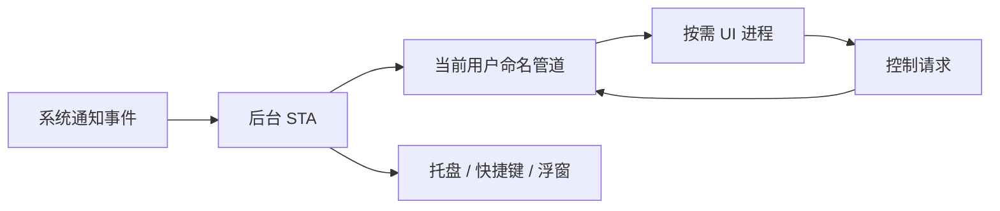

# 架构说明

## 为什么必须是 MSIX 应用

读取其他应用的通知要用 `UserNotificationListener`。这个接口要求调用方有包身份，清单里声明 `userNotificationListener` 能力，并且用户授权过。所以应用必须以 MSIX 包的形式安装和运行，不能做成普通的 exe 或 MSI。打包和签名见 [packaging.md](packaging.md)。

## 模块

| 位置 | 职责 |
|---|---|
| `src/OtpClipboard.Core/OtpParser.cs` | 从通知正文提取验证码，生成遮挡数字后的摘要。 |
| `src/OtpClipboard.Core/NotificationSource.cs` | 按包身份判断通知是否来自“手机连接”，生成来源文字。 |
| `src/OtpClipboard.Core/HistoryArchive.cs` | 历史文件的白名单脱敏、旧格式兼容与数量限制。 |
| `src/OtpClipboard.Core/ErrorText.cs` | 把异常转换成处理记录里显示的中文说明。 |
| `src/OtpClipboard/App.xaml.cs` | 进程入口：默认运行后台，`--ui` 按需启动 WinUI。 |
| `src/OtpClipboard/BackgroundController.cs` | 后台生命周期、原生消息泵、托盘与 UI 启停。 |
| `src/OtpClipboard/BackgroundDispatcher.cs` | 后台 STA 任务队列，承接 WinRT、管道和窗口回调。 |
| `src/OtpClipboard/Api/` | 当前用户命名管道、请求协议、快照和 UI 客户端。 |
| `src/OtpClipboard/AppController.cs` | UI 进程的后台状态适配器与窗口生命周期。 |
| `src/OtpClipboard/Views/MainWindow` | 按需创建的窗口、尺寸与标题栏。 |
| `src/OtpClipboard/Views/MainPage.xaml.cs` | 页面交互；所有状态读写经 `AppController`。 |
| `src/OtpClipboard/Views/MainPage.History.cs` | 后台快照的筛选、摘要与展示。 |
| `src/OtpClipboard/Services/ClipboardService.cs` | 写入剪贴板，被其他程序占用时自动重试。 |
| `src/OtpClipboard/Services/NotificationHistoryStore.cs` | 处理记录的读取和原子写入。 |
| `src/OtpClipboard/Services/NotificationMonitorService.cs` | 通知授权、事件去重、串行识别、复制与内存记录。 |
| `src/OtpClipboard/Services/AppPreferences.cs` | 用户设置（只处理手机连接、显示浮窗、收起到托盘）。 |
| `src/OtpClipboard/Services/StartupService.cs` | 开机自启动，基于 MSIX `StartupTask`。 |
| `src/OtpClipboard/Services/PhoneLinkService.cs` | 检测“手机连接”是否安装和运行，打开“手机连接”。 |
| `src/OtpClipboard/Desktop/DesktopIntegration.cs` | 托盘图标、Ctrl+Alt+O 快捷键、输入框旁的验证码浮窗和点击填入。 |
| `src/OtpClipboard/Desktop/NativeMethods.cs` | 上面用到的 Win32 P/Invoke 声明。 |

依赖方向：UI 的 `Views → AppController → Api`；后台的 `BackgroundController → Services / Desktop → Core`。UI 不直接读取通知、操作剪贴板或持有后台 WinRT 对象。`OtpClipboard.Core` 不引用任何 Windows 专有接口，可以在任何平台上测试。

## 一条通知的处理流程

1. `UserNotificationListener.NotificationChanged` 在后台进程触发，`NotificationMonitorService` 将后续工作调度到后台 STA。
2. 按通知 ID 去重，最近 512 个 ID 内重复的通知会跳过，然后放进处理队列。队列最多积压 200 条，按顺序串行处理，保证剪贴板写入的先后顺序。
3. 读取通知文本，用 `NotificationSource` 判断来源。开启“只识别手机连接”时，其他来源记为“已过滤”。
4. `OtpParser.Extract` 提取验证码，没有就记为“未匹配”。
5. `ClipboardService` 写入剪贴板。如果通知是 2 分钟内产生的，再通过 `DesktopIntegration` 在输入框旁显示浮窗；手动扫描到的旧通知只复制，不弹浮窗。
6. 写入一条 `MonitorRecord`。后台把它记入内存，并将处理分类与时间原子写入历史文件。
7. UI 需要时通过命名管道取一份快照，并在 UI 线程转换为可绑定的 `EventItem`。UI 使用后台持有的命名互斥量阻塞等待进程退出，不再定时连接管道探测存活；关闭 UI 后，快照与后台监听均保持可用。

## 进程与线程边界

- 后台进程随登录、托盘或首次启动常驻，只创建原生隐藏窗口，不创建 WinUI 控件。
- UI 进程由托盘、应用入口或快捷键按需启动。关闭最后窗口后 UI 进程退出，后台继续监听。
- 管道使用 `PipeOptions.CurrentUserOnly`，单条消息上限 256 KiB，不暴露网络端口。
- WinRT 回调、异步续体和管道触发的桌面操作都回到后台 `BackgroundDispatcher` 的单一 STA 线程，避免跨线程创建或操作窗口对象。
- 原生消息泵必须先分发已排队的 `WM_*` 消息，再等待新的任务唤醒句柄；否则消息队列一直非空，空转 CPU。

## 验证码提取规则

规则由 `OtpParser` 实现，`tests/OtpClipboard.Core.Tests` 覆盖了每一条：

- 验证码是 4–8 位 ASCII 数字，前后不能紧挨任何数字，包括全角数字和其他文字的数字。这样不会从发送方的长号码里截出一段。
- 先在全文中找“关键词之后、相隔不超过 24 个非数字字符”的验证码。找不到时，再找“关键词之前、相隔不超过 12 个非数字字符”的验证码。
- 输入为空、超过 16,384 个字符，或正则匹配超时（250 毫秒）时，返回空。
- 摘要（`Preview`）：合并空白，把每段 4–8 位数字遮挡成“首两位 + • + 末两位”，再截断到 120 字。省略号计入长度。

修改规则时，请先在测试中加入能说明问题的用例。

## 本地数据

保存在包的 `LocalState` 目录（`%LOCALAPPDATA%\Packages\<包系列名>\LocalState\`）：

| 文件 | 内容 |
|---|---|
| `preferences.json` | 用户设置 |
| `notification-history.json` | 最近 200 条处理分类与时间（仅 Kind / Time） |

两个文件都是串行写入同目录临时文件，再替换原文件，避免写到一半损坏。历史文件在 Core 层进行白名单校验，只接受已知分类和规定格式的时间。旧版文件中的 Code、Title、Detail 等字段被忽略，并在成功加载后立即重写移除。验证码与通知摘要只留在后台进程内存，并通过按需快照显示在 UI；重启后旧记录不能重新复制。

新增历史字段前必须先评估隐私边界，并补充 HistoryArchiveTests。剪贴板写入禁用 Windows 历史和漫游；应用不自动清除当前剪贴板，也无法控制第三方剪贴板管理器。

## 桌面集成的设计约束

`DesktopIntegration` 直接用 Win32 实现，没有用 WinForms 或 WPF：

- 浮窗设置了 `WS_EX_NOACTIVATE`，显示时不会抢走输入框的焦点。
- “点击填入”通过 `SendInput` 实现。浮窗显示期间会监听前台窗口和焦点的变化；发送前如果发现目标窗口变了，就放弃填入，只保留“已复制”提示。
- 托盘图标会在 Explorer 重启后（`TaskbarCreated` 消息）重新注册。托盘不可用时，主窗口不会被隐藏。
- 托盘、快捷键和浮窗由后台 STA 持有；关闭 WinUI 窗口不会销毁它们。
- 所有桌面方法必须在后台 STA 调用，进程退出时显式销毁隐藏宿主窗口、托盘图标与浮窗资源。
